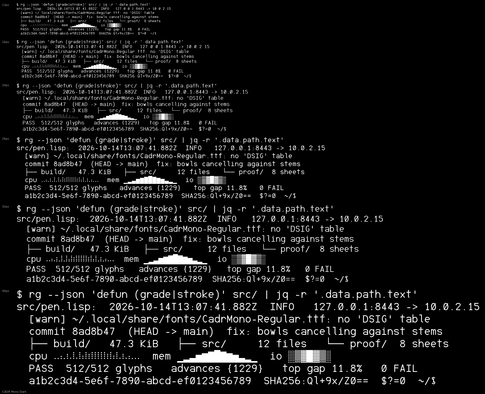
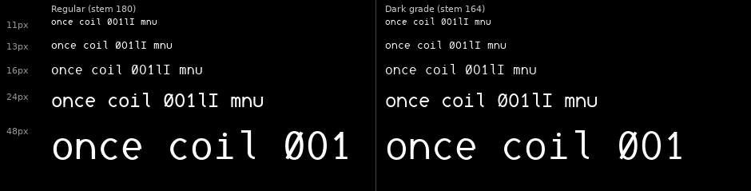
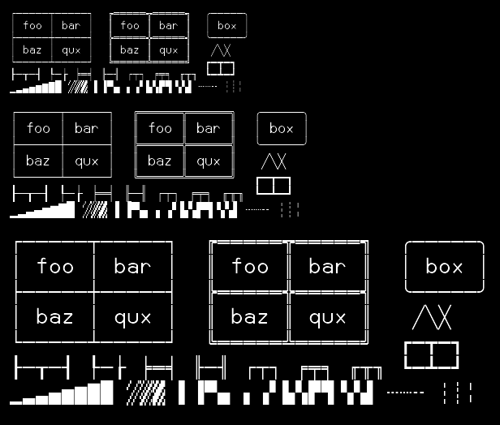
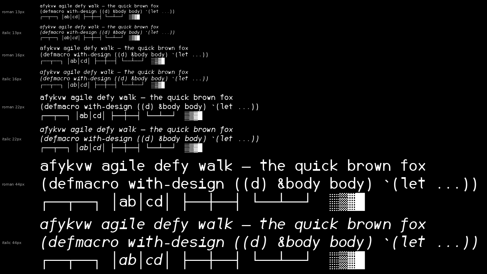

# Muskako

A monospace typeface for terminals and code, generated from Common Lisp.
714 glyphs · 8 static cuts · [OFL 1.1](LICENSE)



Every glyph is a pure function of the parameters in `src/params.lisp`. There are
no drawn outlines and no font editor in the loop: change a number, regenerate,
look at the proofs.

## Install

Hinted TTFs are in [`fonts/`](fonts).

```sh
cp fonts/*.ttf ~/.local/share/fonts/ && fc-cache -f     # Linux
cp fonts/*.ttf ~/Library/Fonts/                         # macOS
```

On Windows, select the eight files, right-click, *Install for all users*.

Then set `Muskako` on a light theme or `Muskako Dark` on a dark one. A running
terminal won't see a newly installed font — restart it.

## What makes it different

**It ships a dark-background cut.** Light text on a dark field looks heavier
than the same text dark-on-light, and every coding font is proofed against
white then used in a terminal. `Muskako Dark` has ink removed for that
polarity — stem 164 against 180 — with *identical* advances and vertical
metrics, so swapping never reflows a column.



**Terminal glyphs are computed from the cell, not drawn.** Box drawing, blocks
and all 256 braille patterns come from the cell's own metrics, which is what
makes them correct: rules reach the cell edges so they meet across the
boundary, arms overrun each junction by half the crossing rule's weight so
corners close square, and braille dots sit at advance/4 so the gap inside a
cell equals the gap across cells. An audit checks 33 box glyphs against their
*Unicode names* on every build.



**Box drawing doesn't slope in the italic.** A sloped rule can't meet its
neighbour across a cell boundary, so box drawing and braille opt out of the
shear. An italic terminal still draws a straight box.

**The italic is drawn, not sloped.** Hack and Liberation Mono redraw *nothing*
for their italics; JetBrains Mono reshapes `f` and `y`; Adwaita Mono reshapes
`f` alone. Muskako reshapes six letters — `a` goes single-storey, `f` gains a
descender, and `k`, `v`, `w` and `y` are redrawn so `value` can't read as
`ualue`.



**It's hinted, because it has to be.** At 13px a whole pixel is 158 units and
the horizontal stroke is 147, so every horizontal is sub-pixel at the sizes
this font exists for. Hinting roughly doubles the share of fully-covered pixels
at 11–13px, measured through FreeType with instructions on and off.

**Proportions were set by measurement,** against JetBrains Mono, Fira Code,
Hack, Adwaita Mono, Noto Sans Mono and Liberation Mono:

| | Muskako | field |
|---|---|---|
| x-height / advance | 0.885 | 0.867–0.917 |
| thin / stem | 0.82 | 0.70–0.89 |
| clearance above tallest glyph | +1.6% | Hack −3.1%, Noto −4.7% |
| `m` ink vs `n` | 1.30× | 1.28×–1.35× |

## Coverage

714 glyphs, every one at advance 1229 on a 2048 em.

| | | | |
|---|---|---|---|
| ASCII 95/95 | Latin-1 96/96 | Greek 49 | Punctuation 15 |
| Math 28 | Box + blocks 160/160 | Braille 256/256 | |

French is complete, including `œ`, the guillemets and the cedilla. There are no
programming ligatures.

## The eight cuts

|  | Regular | Italic | Bold | Bold Italic |
|---|---|---|---|---|
| **Muskako** | ✓ | ✓ | ✓ | ✓ |
| **Muskako Dark** | ✓ | ✓ | ✓ | ✓ |

Family carries the grade, style carries slope and weight, so a terminal's bold
and italic switches land where they should.

## Building

```sh
make -f build/Makefile install
```

Needs `sbcl` and `python3`. The generator has **no Lisp dependencies** — SBCL
alone writes the UFO sources. Everything else lives in a venv the Makefile
creates: `fontmake` to compile, `ttfautohint` to hint, `freetype-py` and
`pillow` for the proofs. Other targets: `sources`, `ttf`, `hint`, `fonts`,
`proof`, `reload`, `clean`.

A letter is a centreline path run under an elliptical pen whose width follows
the local tangent, `w(φ) = hypot(stem·sin φ, thin·cos φ)`, with φ measured
against the stress axis. Strokes that continue into one another are *one path*,
so those joins are continuous by construction. Proofs render from the compiled
font, never from the generator's own contours.

## Contributing

Issues and PRs welcome. There are no drawn outlines, so a change to a letterform
is a change to code — edited UFO or TTF files are build output and can't be
merged. A proportion that's wrong across the font belongs in `src/params.lisp`;
one wrong letter belongs in its builder. Run `make -f build/Makefile proof` and
include the sheet that shows the difference.

## What it is not

The bold is derived from the parameters rather than redrawn. There's no variable
font — `ttfautohint` doesn't support them and hinting is load-bearing here. `&`
isn't a true et-ligature. At 13px the x-height is 6.9px against JetBrains Mono's
7.2, so you may still set it a step larger.

## Licence

[SIL Open Font License 1.1](LICENSE). Use, study, modify and redistribute,
including commercially and bundled with software; don't sell it on its own, and
keep derivatives under the same licence.

There is **no Reserved Font Name**: this font is meant to be rebuilt with
different parameters, and reserving the name would make every adjusted build a
renaming exercise.

Designed and written by Anthony Green. Built with
[fontmake](https://github.com/googlefonts/fontmake),
[ttfautohint](https://www.freetype.org/ttfautohint/) and
[SBCL](https://www.sbcl.org/).
