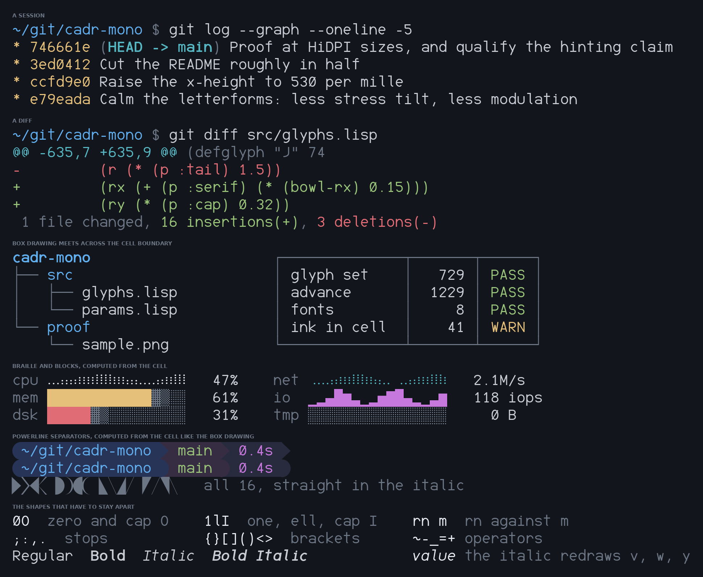

# Cadr Mono

A monospace typeface for terminals and code, generated from Common Lisp.
935 glyphs · 8 static fonts · [OFL 1.1](LICENSE)



Every glyph is a pure function of the parameters in `src/params.lisp`. There are
no drawn outlines and no font editor in the loop.

## Install

Hinted TTFs are in [`fonts/`](fonts).

```sh
cp fonts/*.ttf ~/.local/share/fonts/ && fc-cache -f     # Linux
cp fonts/*.ttf ~/Library/Fonts/                         # macOS
```

On Windows, select the eight files, right-click, *Install for all users*.

Set `Cadr Mono` on a light theme or `Cadr Mono Dark` on a dark one. A running
terminal won't see a newly installed font — restart it.

## Features

- **A dark-background grade.** `Cadr Mono Dark` has ink removed for light-on-dark
  — stem 164 against 180 — with identical advances and vertical metrics, so
  swapping never reflows a column.

- **Box drawing, blocks and braille are computed from the cell.** Rules reach the
  cell edges and meet across the boundary, junction arms overrun by half the
  crossing rule's weight, braille dots sit at advance/4.

- **Box drawing and braille don't slope in the italic**, so an italic terminal
  still draws a straight box.

- **The italic is drawn.** Six letters are reshaped: `a` goes single-storey, `f`
  gains a descender, and `k`, `v`, `w` and `y` are redrawn.

- **Powerline separators are generated**, `U+E0B0`–`U+E0BF`, from the same cell
  metrics as the box drawing.

- **Hinted** with `ttfautohint`. At 13px a whole pixel is 158 units and the
  horizontal stroke is 147. Above 13px the instructions hurt, and `hintslight`
  ignores them entirely.

## Coverage

935 glyphs, every one at advance 1229 on a 2048 em.

| | | | |
|---|---|---|---|
| ASCII 95/95 | Latin-1 96/96 | Latin Ext 94 | Greek 70 |
| Cyrillic 94 | Box + blocks 160/160 | Braille 256/256 | Powerline 16/16 |
| Math 28 | Punctuation 15 | | |

39 European languages set correctly, tested per language against the characters
each needs. Latin Extended covers Polish, Czech, Slovak, Hungarian, Romanian,
Croatian, Slovenian, Serbian, Latvian, Lithuanian, Estonian, Turkish, Maltese and
Welsh. Greek carries the monotonic accents. Cyrillic covers Russian, Ukrainian,
Belarusian, Bulgarian, Serbian and Macedonian.

No programming ligatures.

## The eight fonts

|  | Regular | Italic | Bold | Bold Italic |
|---|---|---|---|---|
| **Cadr Mono** | ✓ | ✓ | ✓ | ✓ |
| **Cadr Mono Dark** | ✓ | ✓ | ✓ | ✓ |

Family carries the grade, style carries slope and weight.

## Nerd Font

```sh
make -f build/Makefile nf        # -> fonts-nf/, "Cadr Mono NF" and "… NF Dark"
```

11,130 codepoints, 2.2 MB a font. Not in `fonts/` and not in git. Icon sources
are vendored in [`src/nerdfont/`](src/nerdfont), pinned to Nerd Fonts v3.5.1.
Font Logos and Pomicons are omitted — see the licence note below — so a build
from here is 145 glyphs short of an official Nerd Font.

## Licence

[SIL Open Font License 1.1](LICENSE), with **no Reserved Font Name**.

The Nerd Font build is the exception: its icons come from eleven upstream sets
under MIT, CC BY 4.0, Apache 2.0 and OFL 1.1, and **all of them require
attribution**. Ship [`src/nerdfont/LICENSES/`](src/nerdfont/LICENSES) with any
build you distribute. Font Logos is marked `unlicensed` upstream and Pomicons'
licence and metadata contradict each other, so neither is vendored here.

Designed and written by Anthony Green. Built with
[fontmake](https://github.com/googlefonts/fontmake),
[ttfautohint](https://www.freetype.org/ttfautohint/) and
[SBCL](https://www.sbcl.org/).
