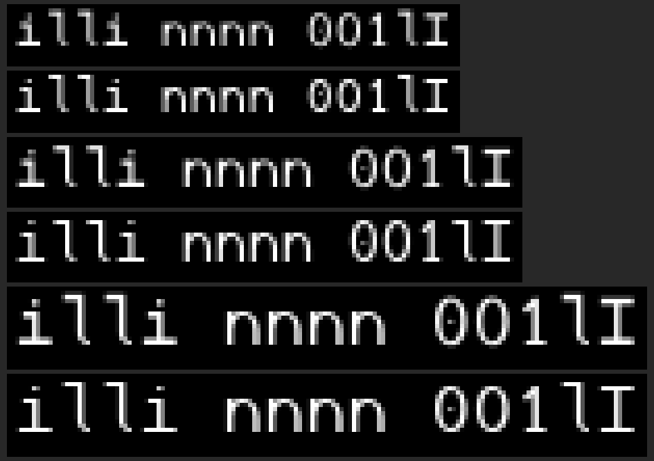
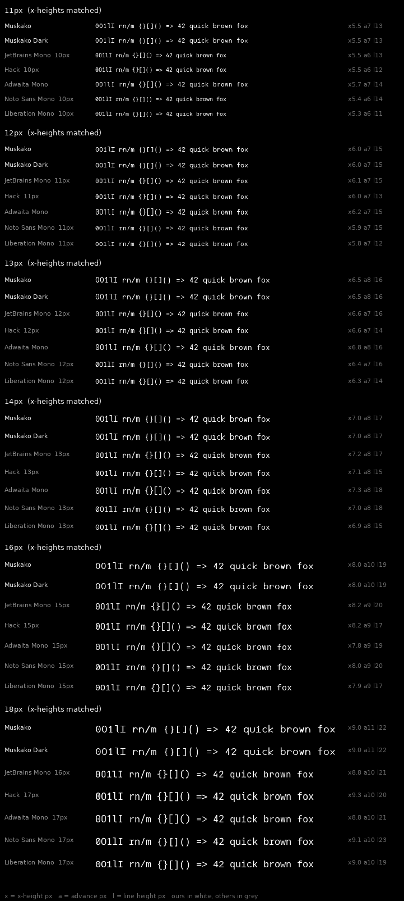
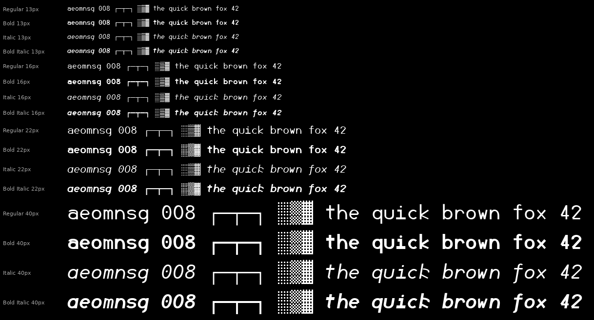

# Muskako

A monospace typeface for terminals and code, generated from Common Lisp.
Version 0.1 · 714 glyphs · 8 static cuts · [SIL Open Font License 1.1](LICENSE)


Every glyph is a pure function of the parameters in `src/params.lisp`. There are
no drawn outlines and no font editor in the loop: change a number, regenerate,
and look at the proofs. 714 glyphs across 8 cuts come out of about 3,500 lines
of Lisp.

## Install

Pre-built, hinted TTFs are in [`fonts/`](fonts). Download the eight files, or
clone the repository, then:

**Linux**

```sh
mkdir -p ~/.local/share/fonts
cp fonts/*.ttf ~/.local/share/fonts/
fc-cache -f
```

**macOS** — select the eight `.ttf` files, open them, and click *Install Font*.
Or `cp fonts/*.ttf ~/Library/Fonts/`.

**Windows** — select the eight `.ttf` files, right-click, and choose
*Install for all users*.

Then set `Muskako` as your terminal and editor font on a light theme, or
`Muskako Dark` on a dark one. An already-running terminal will not see a newly
installed font; restart it.

---

## What makes it different

### It ships a dark-background cut


Light text on a dark field looks heavier than the same text dark-on-light. The
effect is partly optical — bright shapes bleed outward on the retina — and
partly the rasteriser's, and the two can pull in opposite directions depending
on the stack. Coding fonts are drawn and proofed against a white canvas, then
used in a terminal, which is the other polarity.

Muskako ships two **grades**: the reference cut, and a cut with ink removed for
light-on-dark. Stem 88 against 80 per mille, 8 units off each side.

Crucially they have **identical advance widths and vertical metrics**, so
swapping one for the other never reflows a column.

### Terminal glyphs are computed from the cell, not drawn


Box drawing, block elements and all 256 braille patterns are generated from the
cell's own metrics. That isn't a shortcut — it's what makes them correct:

- **Rules reach the cell edges** horizontally and vertically, so they meet
  across the boundary instead of leaving the gap that shows up in `lazygit` and
  `tmux` borders when a font gets this wrong.
- **Arms overrun each junction** by half the crossing rule's weight, so corners
  close square rather than notching.
- **Braille dots sit at advance/4 and 3·advance/4**, so the gap inside a cell
  equals the gap across cells. `btop` graphs tile evenly rather than reading as
  a dotted ladder.
- **Shade blocks use an ordered dither**, measuring 25.0%, 50.0% and 75.0%
  coverage against the font's own cell.

An arm audit checks 33 box glyphs against their *Unicode names* — not against
the tables that generate them — on every build.

### Box drawing does not slope in the italic

A sloped rule cannot meet its neighbour across a cell boundary. Box drawing and
braille are placed against the cell rather than centred in it, and they opt out
of the shear along with the centring. An italic terminal still draws a straight
box.

### The italic is drawn, not sloped


Measured across the field: Hack and Liberation Mono redraw *nothing* for their
italics; JetBrains Mono reshapes `f` and `y`; Adwaita Mono reshapes `f` alone.

Muskako reshapes six letters. `a` goes single-storey — the signature of a drawn
italic. `f` gains a descender. `y` trades two straight diagonals for a trough
with a sweeping tail. `k`'s arm curves into the stem instead of striking it.
`v` and `w` become rounded feet with converging sides, narrow enough that
`value` cannot read as `ualue`.

### It is hinted, because it has to be



At 2048 units per em a whole pixel is 158 units at 13px. The horizontal stroke
is 127. Every horizontal in this font is sub-pixel at the sizes it exists for,
and unhinted they wash out to grey.

Hinting roughly doubles the share of fully-covered pixels at 11–13px, measured
by rendering the same file through FreeType with instructions on and off. That
is what makes the humanist modulation affordable at all.

### Every proportion was set by measurement



| | Muskako | field |
|---|---|---|
| advance / line box | 0.496 | Hack 0.517, Adwaita 0.508, JetBrains 0.455 |
| clearance above tallest glyph | +1.7% | Hack −3.1%, Noto −4.7%, Liberation −5.6% |
| bold stem ratio | 1.44× | 1.32×–1.58× |
| `m` ink vs `n` | 1.27× | 1.28×–1.35× |
| accent height over a capital | 32% of cap | 26%–39% |

---

## Coverage

714 glyphs, 713 codepoints, every one at advance 1229.

| block | |
|---|---|
| ASCII | 95 / 95 |
| Latin-1 Supplement | 96 / 96 |
| Greek | 49 |
| General punctuation | 15 |
| Mathematical operators | 28 |
| Box drawing + block elements | 160 / 160 |
| Braille patterns | 256 / 256 |

Latin-1 plus the accent set covers the Western European languages — French is
complete, including `œ`, the guillemets and the cedilla. λ and the full Greek
lowercase are there, with the arrow, set and logic operators.

There are **no programming ligatures**, no stylistic sets and no `cv__`
alternates. See [What it is not](#what-it-is-not).

## The eight cuts



|  | Regular | Italic | Bold | Bold Italic |
|---|---|---|---|---|
| **Muskako** | ✓ | ✓ | ✓ | ✓ |
| **Muskako Dark** | ✓ | ✓ | ✓ | ✓ |

Family carries the grade; style carries slope and weight, so a terminal's italic
and bold switches land where they should.

## Metrics

```
units per em     2048
advance          1229        (0.600 em — Courier New's ratio at 2048)
cap height       1434
x-height         1024        (exactly half the em; x/cap 0.714)
ascender         1556        letters
descender        -230        letters
line box         1884 / -594 the cell a terminal reserves
stem             180         regular · 164 dark grade · 260 bold
```

Letter extents and line extents are separate parameters. Collapsing them is what
leaves a font with no headroom, and it is why accented capitals overflow the cell
in much of the field.

---

## Building

```sh
make -f build/Makefile install      # sources → ttf → hint → proofs → install
```

That writes UFO sources, compiles them with `fontmake`, hints with
`ttfautohint`, refreshes `fonts/`, regenerates every proof sheet, and installs
to `~/.local/share/fonts`.

Requires `sbcl` and `python3`. The generator has **no Lisp dependencies** —
SBCL alone writes the UFO sources, and `sbcl --script build/build.lisp` does
just that step. Everything else lives in a Python venv the Makefile creates on
first run: `fontmake` to compile, `ttfautohint` to hint, `freetype-py` and
`pillow` to render the proofs.

Other targets: `sources`, `ttf`, `hint`, `fonts`, `proof`, `clean`.

### Making it the default monospace font

```sh
cat > ~/.config/fontconfig/conf.d/60-muskako.conf <<'EOF'
<?xml version="1.0"?>
<!DOCTYPE fontconfig SYSTEM "urn:fontconfig:fonts.dtd">
<fontconfig>
  <alias><family>monospace</family>
    <prefer><family>Muskako</family></prefer>
  </alias>
</fontconfig>
EOF
fc-cache -f
gsettings set org.gnome.desktop.interface monospace-font-name 'Muskako 12'
```

---

## How it is put together

```
src/params.lisp      the design: every number, written per mille
src/geom.lisp        contours, bezier arcs, winding
src/pen.lisp         skeleton-and-pen stroking, extrema insertion
src/primitives.lisp  stems, bowls, shoulders, ink measurement
src/glyphs.lisp      the letters, as pure functions of the parameters
src/accents.lisp     marks, and the letters composed from them
src/latin1.lisp      ligatures, symbols, currency
src/greek.lisp       Greek
src/symbols.lisp     arrows, operators, typographic marks
src/braille.lisp     all 256 patterns, generated
src/boxes.lisp       box drawing and blocks, from the cell metrics
src/diagnose.lisp    measurement: fit, colour, extrema, arms
src/ufo.lisp         UFO 3 output
```

A letter is a **centreline path run under an elliptical pen** whose width
follows the local tangent:

```
w(φ) = hypot(stem·sin φ, thin·cos φ)
```

with φ measured against the stress axis. Modulation is continuous around every
curve, the thin spots land on the stress axis by construction, and terminals are
cut relative to the stroke rather than to the coordinate system.

Strokes that continue into one another are *one path* — `l`'s stem into its tail,
`n`'s shoulder into its right leg — so those joins are continuous by
construction rather than two parts abutted and hoped over.

Proofs render from the **compiled font** (UFO → fontmake → TTF → FreeType), not
from the generator's own contour lists. An instrument that reads the same data
structures the generator writes shares all of its assumptions.

## Contributing

Issues and pull requests are welcome.

Because there are no drawn outlines, a change to a letterform is a change to
code or to a parameter — not to a `.glif`. Edited UFO or TTF files cannot be
merged; they are build output, and the next `make` overwrites them.

- **A proportion is wrong across the font** — adjust `src/params.lisp` and say
  what the new number is measured against.
- **One letter is wrong** — change its builder in `src/glyphs.lisp` (or the
  relevant `src/*.lisp`).
- Run `make -f build/Makefile proof` and include the proof sheet that shows the
  difference. Judge weight and fit from those sheets, not from the Lisp.

## Credits

Designed and written by Anthony Green.

Built with [fontmake](https://github.com/googlefonts/fontmake),
[ttfautohint](https://www.freetype.org/ttfautohint/),
[FreeType](https://freetype.org/) and [SBCL](https://www.sbcl.org/).
Proportions were measured against JetBrains Mono, Hack, Adwaita Mono,
Noto Sans Mono, Liberation Mono and Nimbus Mono.

---

## What it is not

**It reads smaller than the defaults.** At 13px its x-height is 6.5px against
JetBrains Mono's 7.2 and Hack's 7.1 — about ten percent smaller at the same
setting. That is the restrained x-height arriving as a consequence, and you will
probably set it one step larger than you set those.

**It trades horizontal density for vertical.** The line box is tighter than the
field's, so more rows fit; at matched x-height the advance is wider, so fewer
columns do.

**There are no programming ligatures.** No `=>`, no `!==`. Nothing prevents them
in the construction, but they are not drawn.

**The bold is derived, not drawn.** It comes from the same parameters with a
heavier pen and a crowding allowance that measurement put inside the field's
range. A foundry would redraw the crowded letters rather than let parameters
handle them.

**There is no variable font.** `ttfautohint` does not support variable fonts and
appears unmaintained, and hinting is load-bearing here. Static cuts are the
deliverable; terminals install static TTFs anyway.

**`&` is not a true et-ligature.** Its proper spine does not land by
construction, so what ships is assembled from parts.

## Licence

Muskako is licensed under the [SIL Open Font License, Version 1.1](LICENSE).
You may use, study, modify and redistribute it, including commercially and
including bundled with software; you may not sell it on its own, and derivatives
must stay under the same licence.

There is **no Reserved Font Name**: this font is meant to be rebuilt with
different parameters, and reserving the name would make every adjusted build a
renaming exercise.
